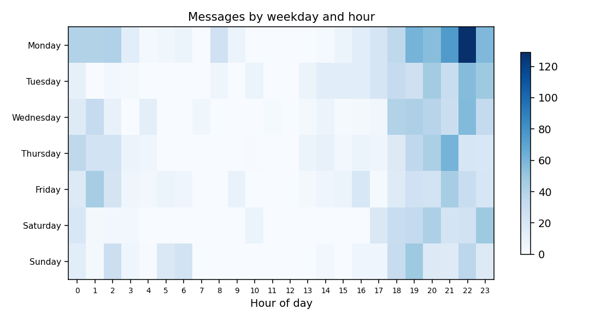

# chatlens — WhatsApp Chat Intelligence

Privacy-first parsing, analytics and NLP for exported WhatsApp chats (individual & group; Android & iOS exports;
English, Urdu, Hindi, Roman-Urdu/Hinglish), plus a reproducible Colab pipeline that benchmarks NLP methods on Kaggle corpora.

> **Read this first — what is and isn't verified.** Everything below marked ✅ was executed and tested during the build.
> Items marked ⚠️ are written but **could not be run** in the build sandbox (no GPU, no Hugging Face / Kaggle access, no Docker).
> The original GitHub project contained only an empty notebook, so this is a from-scratch build, not an upgrade.

## What you get
| | Status |
|---|---|
| Robust parser (Android 12h/24h, iOS, multi-line, system/media/deleted/edited, date-order inference, full row accounting) | ✅ |
| Preprocessing (URLs, emoji, Unicode normalisation, Urdu/Hindi-safe tokenisation, language ID, stopwords) + data-quality validation | ✅ |
| Analytics: overview, temporal (heatmap, streaks, silences, trend), participants, behaviour (sessions, initiation, response times, interaction matrix), text (n-grams, emoji, domains, distinctive vocabulary) | ✅ tested against ground truth |
| Statistics with effect sizes (Kruskal–Wallis, Mann–Whitney, χ², Spearman, Theil–Sen, bootstrap CIs, McNemar+Holm) | ✅ |
| Sentiment benchmark — 13 methods on real Roman-Urdu data | ✅ CPU methods measured (below); ⚠️ 6 transformer methods written, not run |
| Emotion benchmark (≥10 methods), English sentiment benchmark | ⚠️ run by the notebook (needs Kaggle) |
| Topic modelling (6 methods × k sweep), keyword extraction (6 methods) | ✅ classical methods run on real text in a notebook smoke-run; ⚠️ embedding/BERTopic need `sentence-transformers`/`bertopic` |
| Colab notebook: Drive, Kaggle API, checkpoint/resume, manifest, MLflow, final report | ✅ executed end-to-end locally in smoke mode; ⚠️ never run on Colab itself |
| Gradio dashboard + `/healthz`, upload validation, retention, anonymisation, feedback tab | ✅ tested over real HTTP |
| Dockerfile, Compose (hardened), GitHub Actions CI | ⚠️ written, **not built/run** (no Docker here) |

## Measured results (real data, real run)
Roman Urdu sentiment, 19,372 cleaned sentences (from 20,229; dedup + conflicts removed before the split), test n = 3,875, 95% bootstrap CI:

| Method | Macro-F1 [CI] | Accuracy | ROC-AUC | ECE |
|---|---|---|---|---|
| TF-IDF word+char + LogReg | **0.664** [0.650, 0.678] | 0.670 | 0.830 | 0.015 |
| TF-IDF char + LogReg | 0.650 [0.635, 0.664] | 0.657 | 0.823 | 0.016 |
| TF-IDF word+char + calibrated LinearSVC | 0.649 [0.634, 0.663] | 0.663 | 0.832 | 0.050 |
| TF-IDF word + ComplementNB | 0.615 | 0.618 | 0.795 | 0.140 |
| VADER / TextBlob (English lexicons) | 0.32 / 0.31 | 0.39 / 0.42 | — | — |
| Majority baseline | 0.201 | 0.431 | 0.500 | — |

The top three are statistically close (the calibrated SVC is *indistinguishable* from the best, Holm-adjusted). English lexicons
barely beat the baseline on Roman Urdu — which is why the app never applies them to Hinglish. **In-domain (WhatsApp) accuracy is unknown**; full tables and caveats: `docs/results/sentiment_roman_urdu_sandbox.md`.


*Example output on a **fabricated** demo chat: patterns reflect generator settings, not human behaviour.*

## Quick start
```bash
pip install -e ".[app,tracking,dev]"         # Python ≥ 3.10 (tested on 3.12; CI covers 3.10–3.12)
pytest                                       # 226 tests, 94% coverage
CHATLENS_MODEL_DIR=models chatlens-app       # http://localhost:7860  (use "Try with fabricated demo data" first)
```
Library use:
```python
from chatlens.ingestion import read_chat
from chatlens.analyze import analyze_chat, NLPOptions
b = analyze_chat(read_chat("WhatsApp Chat.txt").text, anonymize_names=True)
print(b.overview["total_messages"], b.behavior["response_summary"]["overall"])
```
Export a chat: WhatsApp → chat → ⋮ → More → Export chat → **Without media**.

## Google Colab (the full data-science pipeline)
1. Push this folder to `github.com/anil-67140/DS_chatlens` (or upload `chatlens.zip` to `Drive/chatlens_project/`).
2. Open `notebooks/chatlens_colab.ipynb` in Colab; runtime **T4 GPU**.
3. **Kaggle API**: kaggle.com → Settings → API → *Create New Token*; add it as Colab secret `KAGGLE_API_TOKEN` (legacy `KAGGLE_USERNAME`+`KAGGLE_KEY` also work). Open each dataset page once to accept terms.
4. Run all cells. Everything lands in `Drive/chatlens_project/`. Disconnected? **Run again** — verified stages are skipped.
5. Your own chat: put it in `Drive/chatlens_project/chats/`, set `CHAT_FILE`. Otherwise a fabricated demo chat is used (and labelled).

Drive layout: `data/raw|processed` · `nlp/<task>/<method>/` (result, predictions, fitted model) · `topics/` · `keywords/` · `models/` (+ model card, drift reference) · `reports/{tables,figures,chat}` · `mlflow/` · `logs/` · `manifest.json` · `deliverables/*.zip` (excludes your chats and raw third-party data).
Download: Drive web UI → `chatlens_project/deliverables/` (or right-click the folder → Download).

## Docker / deployment
```bash
docker compose up --build        # ⚠️ not built in the dev sandbox; CI job `docker` builds it and probes /healthz
```
Compose binds to `127.0.0.1`, read-only FS, tmpfs scratch, no capabilities. **The app has no authentication**: to expose it, put a reverse proxy with auth/TLS in front. Hugging Face Spaces (Docker/Gradio SDK) or any container host works with the same image. Env: `CHATLENS_MAX_UPLOAD_MB`, `CHATLENS_RETENTION_MINUTES`, `CHATLENS_MODEL_DIR`, `CHATLENS_FEEDBACK_FILE`, `PORT`.

## Project structure
```
src/chatlens/  config · exceptions · ingestion · checkpoint · kaggle_data · tracking · monitoring · privacy · stats · synthetic
               parsing/ · preprocessing/ · analytics/ · nlp/ · viz · report · analyze · experiments · app/
notebooks/chatlens_colab.ipynb   models/sentiment_roman_urdu.joblib   configs/default.yaml
tests/ (226)   docs/ (audit, architecture, methodology, datasets, privacy, monitoring, results)
Dockerfile · docker-compose.yml · .github/workflows/ci.yml · requirements*.txt (pinned) · Makefile
```

## Documentation
`docs/00_audit_and_gap_analysis.md` · `ARCHITECTURE.md` · `METHODOLOGY.md` (assumptions & limitations per feature) · `DATASETS.md` · `PRIVACY.md` · `MONITORING_AND_MODEL_UPDATES.md` · `results/`

## Known limitations
* Parser formats come from documented layouts; **not verified on a real export from your phone** or on non-English locales.
* Response-time/“no reply” metrics are inferences; sentiment/emotion/topic outputs are model predictions with benchmark-level error.
* Transformer, embedding, BERTopic, NER and toxicity code paths are **untested against real models** (the fine-tuning loop, label mapping and consent gating are tested with stand-ins). The notebook's first transformer cell is the real test — expect to fix small API drift.
* Urdu/Hindi *script* sentiment has no trained model here (unscored unless you register one).
* Python 3.10/3.11 untested locally (pandas 2.2 + scikit-learn 1.4 were tested on 3.12; CI will cover the rest).
* No licence file is included: choose one (note the Roman Urdu data mirror is GPL-3.0).
